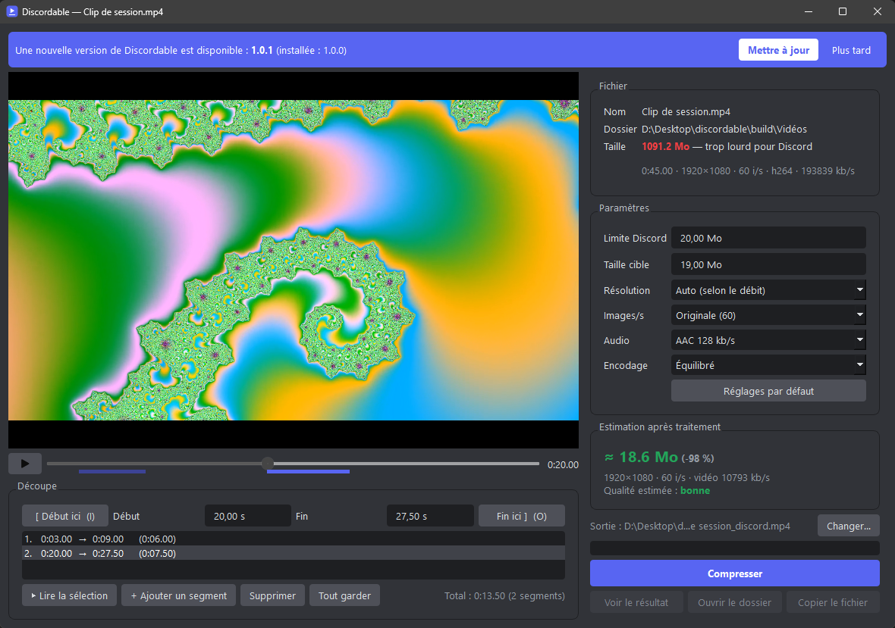
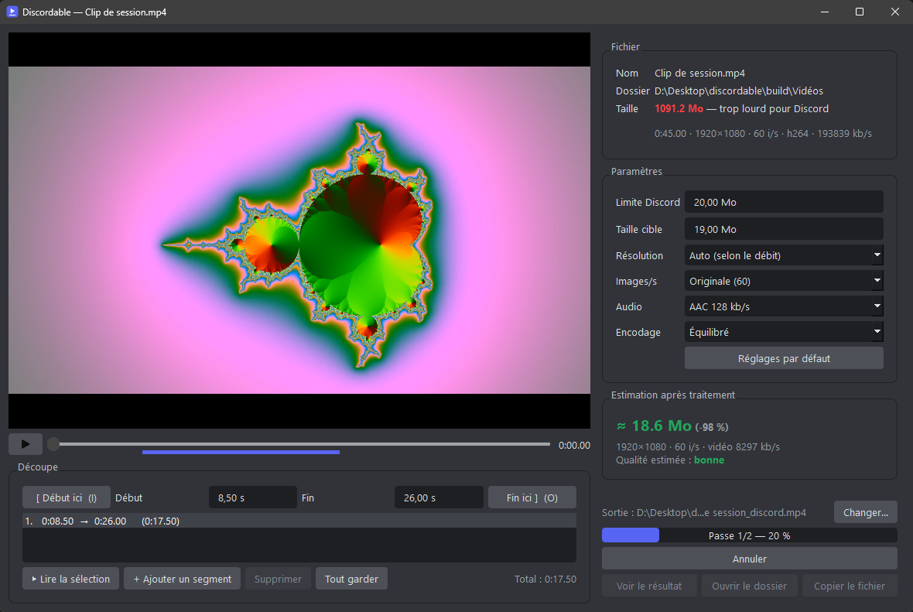
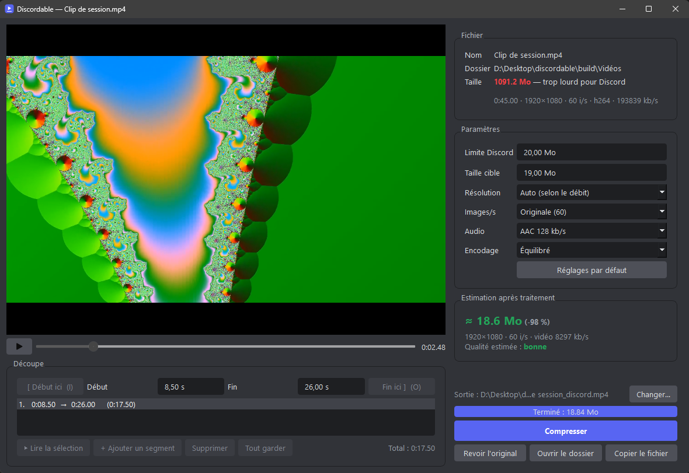

# Discordable

Compresse une vidéo pour qu'elle passe sous la limite d'upload de Discord, directement depuis le clic droit de l'Explorateur Windows.



| Encodage en cours | Résultat : 1 Go → 18,8 Mo |
|---|---|
|  |  |

## Fonctionnalités

- **Clic droit → Discordable** sur n'importe quelle vidéo (mp4, mkv, mov, avi, webm, wmv, flv, m4v, ts, mpg, 3gp).
- Nom, dossier et taille du fichier : la taille s'affiche **en rouge** si elle dépasse la limite Discord (20 Mo par défaut, modifiable).
- **Aperçu vidéo** avec lecture, timeline cliquable et **découpe début / fin** (touches `I` et `O`, `Espace` pour lecture/pause).
- **Plusieurs segments** : garde autant de morceaux que tu veux, n'importe où dans la vidéo ; ils sont mis bout à bout à l'encodage et « Lire la sélection » prévisualise le montage.
- **Estimation du poids final** et de la qualité, recalculée en direct à chaque réglage.
- Paramètres : taille cible, résolution (auto, originale, 1080p → 360p), images/s, audio (AAC ou muet), vitesse d'encodage.
- Encodage H.264 en **deux passes** pour viser la taille au plus juste, avec réajustement automatique si le fichier dépasse.
- Après traitement : **aperçu du résultat**, ouverture du dossier, ou **copie du fichier** pour le coller (`Ctrl+V`) dans Discord.
- Les derniers réglages sont mémorisés ; un bouton remet les réglages par défaut.
- **Mises à jour** : au lancement, l'appli vérifie les nouvelles versions sur GitHub. Un clic sur « Mettre à jour » télécharge et installe la nouvelle version, puis rouvre la vidéo en cours.

## Installation

Télécharge `Discordable-Setup-x.y.z.exe` dans les [Releases](https://github.com/acotinier/discordable/releases) et lance-le. Aucun droit administrateur n'est nécessaire et FFmpeg est inclus.

L'entrée **Discordable** apparaît dans le clic droit des vidéos. Sous Windows 11, elle se trouve dans « Afficher plus d'options » (ou `Maj + clic droit`). La désinstallation (Paramètres → Applications) retire aussi l'entrée du clic droit.

### Depuis les sources

Prérequis : Windows, [Python 3.10+](https://www.python.org/) et [FFmpeg](https://ffmpeg.org/).

```bash
winget install Gyan.FFmpeg
pip install -r requirements.txt
python discordable.py --install
```

FFmpeg est cherché dans le dossier `ffmpeg\` de l'appli, puis dans le `PATH`, puis dans le dossier d'installation winget. Pour retirer l'entrée du clic droit :

```bash
python discordable.py --uninstall
```

## Utilisation sans clic droit

```bash
python discordable.py "C:\chemin\vers\video.mp4"
```

Sans argument, une fenêtre permet de choisir le fichier.

La vidéo compressée est enregistrée à côté de l'originale sous le nom `<nom>_discord.mp4` (modifiable avec « Changer… »).

## Tests

```bash
python test_discordable.py
```

Vérifie le calcul des réglages puis encode une vraie vidéo de test avec FFmpeg.

## Construire l'installeur

```bash
pip install pyinstaller
winget install JRSoftware.InnoSetup
python build.py
```

Produit `build/Discordable-Setup-<version>.exe` (la version vient de `__version__` dans `discordable.py`). FFmpeg est téléchargé depuis [gyan.dev](https://www.gyan.dev/ffmpeg/builds/) au premier build.

## Licences tierces

L'installeur embarque [FFmpeg](https://ffmpeg.org/) (build de gyan.dev, sous licence GPL v3, texte fourni dans `ffmpeg\LICENSE.txt`) et [Qt / PySide6](https://www.qt.io/qt-for-python) (LGPL v3).
